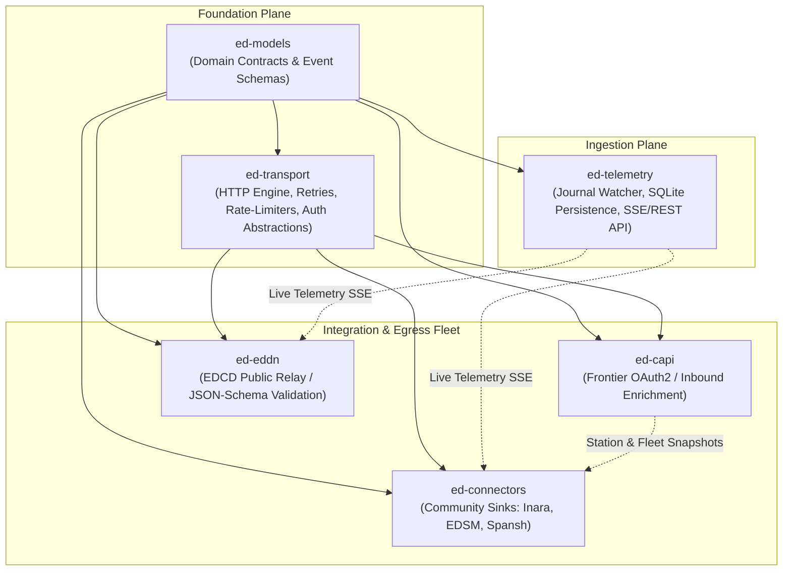

# ADR 0035: Integration Fleet Decomposition and Boundary Taxonomy

## Context and Problem Statement

The legacy `EDMarketConnector` codebase combines event harvesting, cockpit state tracking, Frontier Companion API (CAPI) synchronization, third-party network transmission (EDDN, Inara, EDSM, Spansh, Coriolis), configuration management, and a Tkinter desktop GUI into a single monolithic process.

With `ed-telemetry` now operational as an isolated, standalone ingestion daemon and event streaming server, the broader architecture must plan the decomposition of the remaining legacy capabilities into a modular fleet of discrete, single-responsibility packages.

A core architectural challenge emerges regarding third-party external integrations:
1. Frontier CAPI, EDDN, and community platforms (Inara, EDSM, Spansh) all require HTTP transport primitives: retry backoff, exponential jitter, connection pooling, rate-limiting, authentication token injection, and structured schema serialization.
2. Code generation templates (e.g. Copier/Cookiecutter) duplicate operational plumbing across repositories, creating significant maintenance drift when transport bug fixes, security patches, or connection pool tuning are required.
3. Monolithic integration packages violate the Single Responsibility Principle, forcing frequent release cycles across unrelated endpoints when a single third-party endpoint alters its API schema.
4. UI presentation concerns (GUI/TUI) must be kept strictly separated from domain models, telemetry streaming, and network transport.

How should the `ed-*` package fleet decompose third-party network outreach, shared transport mechanisms, and domain models into maintainable, versioned boundaries?

## Decision Drivers

* **Single Responsibility & Fault Isolation:** An outage, schema change, or authentication failure on one third-party service (e.g., Inara or Spansh) must never impact public galactic data contribution (EDDN) or core ingestion (`ed-telemetry`).
* **Shared Transport Protocol Core:** Universal HTTP transport mechanics (exponential backoff with jitter, token bucket rate-limiting, circuit breakers, offline request buffering, and credential provider abstractions) must reside in a shared, versioned dependency rather than duplicated via templates.
* **Separation of Inbound Enrichment vs. Outbound Egress:** Frontier CAPI is an authenticated inbound state source (pulling account outfitting, fleet, and market state). EDDN and community platforms are outbound egress sinks (relaying telemetry).
* **Strict Exclusion of Presentation/UI Planes:** Focus purely on data models, transport protocols, state aggregation, and network integration. Presentation layers (TUI/GUI) remain explicitly out of scope for this architecture.
* **Hexagonal Architectural Invariants:** Each integration package must follow Hexagonal Architecture (Ports and Adapters), depending only on standard abstractions and shared core libraries.

## Considered Options

* **Option 1: Extreme Consolidation (`ed-integrations` Monolith).** Implement a single umbrella package housing CAPI, EDDN, and all community connectors. *(Rejected: High coupling; breaking changes or dependency updates in one connector trigger cascade version bumps and deployments for all consumers).*
* **Option 2: Extreme Micro-Packaging ($1:1$ Service Repository).** Create separate repositories for every single destination (`ed-eddn`, `ed-capi`, `ed-inara`, `ed-edsm`, `ed-spansh`, `ed-coriolis`) and duplicate transport plumbing using Copier templates. *(Rejected: Maintenance overhead of managing 6+ independent CI/CD pipelines and the anti-pattern of template drift for shared HTTP mechanics).*
* **Option 3: Layered Fleet Taxonomy with Shared Transport & Domain Packages.** Decompose the integration plane into five distinct packages aligned by functional trust, protocol paradigms, and lifecycle characteristics:
  * `ed-models`: Core data schemas, event definitions, and enums.
  * `ed-transport`: Shared HTTP client engine, rate-limiters, backoff, and auth abstractions.
  * `ed-capi`: Dedicated Frontier Companion API client (OAuth2/PKCE inbound enrichment).
  * `ed-eddn`: Dedicated EDCD public data relay (strict JSON-Schema validation, high-throughput outbound sink).
  * `ed-connectors`: Unified multi-destination gateway for community tracking platforms (Inara, EDSM, Spansh).

## Decision Outcome

Chosen Option: **Option 3: Layered Fleet Taxonomy with Shared Transport & Domain Packages**.

### Architectural Package Specifications

#### 1. `ed-models` (Domain Contracts & Event Schemas)
* **Role:** Universal shared library providing immutable event models, game entities, and enums.
* **Responsibilities:**
  - Strongly typed Pydantic / Msgspec definitions for Elite Dangerous journal events (`FSDJump`, `Docked`, `Market`, `Outfitting`, etc.).
  - Static game classifications (star classes, planetary types, ship hulls, module slots, engineering recipes).
  - Pure Python data structures with zero network or filesystem dependencies.

#### 2. `ed-transport` (Resilient Network Transport Core)
* **Role:** Reusable network execution engine powering all external API outreach.
* **Responsibilities:**
  - Standardized HTTP client session with configurable connection pooling and timeouts.
  - Resilient retry policies with exponential backoff and randomized jitter.
  - Token-bucket and sliding-window rate limiters adhering to third-party API quotas.
  - Pluggable `CredentialProvider` contracts (pre-shared key, Bearer token, basic auth, dynamic file reload).
  - Circuit breaker primitives and dead-letter queue / offline spooling interfaces.

#### 3. `ed-capi` (Frontier Companion API Client)
* **Role:** Dedicated client for Frontier Developments Companion API.
* **Dependencies:** `ed-models`, `ed-transport`.
* **Characteristics:**
  - Protocol: OAuth2 Authorization Code Grant with PKCE.
  - Operation: Inbound enrichment (pulls raw `/profile`, `/market`, and `/shipyard` JSON).
  - Security: Keyring integration for secure user token storage; automated token refresh cycles.
  - Rate Limiting: Strict polling cooldowns to prevent Frontier account throttling.

#### 4. `ed-eddn` (EDCD Public Data Network Relay)
* **Role:** Dedicated outbound gateway for the Elite Dangerous Data Network (EDDN).
* **Dependencies:** `ed-models`, `ed-transport`.
* **Characteristics:**
  - Protocol: Unauthenticated HTTP POST submissions to public EDDN ingest gateways.
  - Validation: Strict client-side validation against official EDCD JSON-Schema specifications prior to wire transmission.
  - Pipeline: Batching, message deduplication, and software identification headers.
  - Governance: Maintained strictly to EDCD community standards.

#### 5. `ed-connectors` (Community Network Gateway)
* **Role:** Multi-destination adapter engine for third-party pilot tracking services.
* **Dependencies:** `ed-models`, `ed-transport`.
* **Characteristics:**
  - Destinations: Inara (API v2), EDSM (API v1), Spansh (API v1), Coriolis / EDSY.
  - Paradigm: Outbound telemetry sync and bidirectional query resolution (e.g. commander ranks, system exploration state).
  - Architecture: Each destination is implemented as an isolated Hexagonal driven adapter behind a unified `CommunitySyncPort`.
  - Credentials: Per-service user API keys managed via secure local configuration.

## Positive Consequences

* **Zero Transport Duplication:** Common HTTP retries, rate-limiting, and error-handling algorithms are tested and maintained centrally in `ed-transport`.
* **Total Fault Isolation:** An API revision or deprecation in Inara or EDSM only touches `ed-connectors`, leaving EDDN public broadcast and CAPI ingestion untouched.
* **Clean Downstream Dependency Graph:** Packages depend strictly downwards on `ed-models` and `ed-transport` without cyclical imports or cross-integration coupling.
* **Focused Maintenance Scope:** Each package maintains its own focused test suite, CI quality gates, and semver release cadence.
