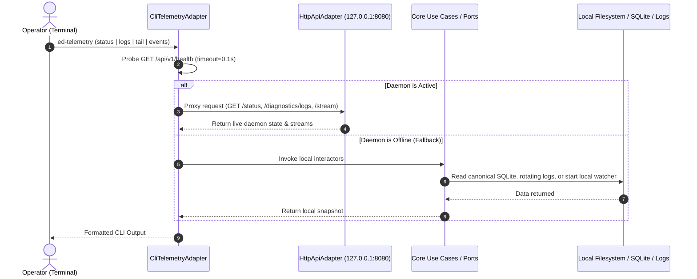

# SDD-025: CLI Hybrid IPC Architecture and Canonical State Path Anchoring

## 1. System Overview

This Software Design Document specifies the engineering implementation required to resolve Issues #67, #68, #69, and #70 according to ADR 0027.

## 2. Component Architecture & Sequence



---

## 3. Detailed Component Modifications

### 3.1 Canonical Persistence Path Anchoring (Issue #69)

#### `src/ed_telemetry/bootstrap/container.py`
Add `resolve_default_db_path()`:
```python
def resolve_default_db_path(platform: str | None = None) -> Path:
    """Resolve cross-platform SQLite database path according to OS standards."""
    current_platform = platform or sys.platform

    if current_platform == "win32":
        local_app_data = os.environ.get("LOCALAPPDATA")
        if local_app_data:
            return Path(local_app_data) / "ed-telemetry" / "telemetry.db"
        user_profile = os.environ.get("USERPROFILE")
        if user_profile:
            return Path(user_profile) / ".cache" / "ed-telemetry" / "telemetry.db"
        return Path.home() / ".cache" / "ed-telemetry" / "telemetry.db"

    # Linux / Steam Deck / Unix
    xdg_data_home = os.environ.get("XDG_DATA_HOME")
    if xdg_data_home:
        return Path(xdg_data_home) / "ed-telemetry" / "telemetry.db"

    return Path.home() / ".local" / "share" / "ed-telemetry" / "telemetry.db"
```
Update `build_container()`:
```python
effective_db = Path(db_path) if db_path else resolve_default_db_path()
```

---

### 3.2 Watcher Lazy Discovery & Active Journal (Issue #68)

#### `src/ed_telemetry/adapters/driven/watcher/watcher.py`
Update `journal_dir` property to trigger path discovery when uninitialized:
```python
@property
def journal_dir(self) -> str | None:
    with self._lock:
        if self._journal_dir is None:
            discoverer = PathDiscoverer()
            res = discoverer.discover_journal_directory()
            self._journal_dir = res.resolved_path
        return str(self._journal_dir) if self._journal_dir is not None else None
```

#### `src/ed_telemetry/core/use_cases/get_watcher_status.py`
Query active journal from candidate list:
```python
def get_status(self) -> WatcherStatusDTO:
    journal_dir = self._watcher.journal_dir
    active_journal = None
    if journal_dir:
        candidates = self._watcher.list_journals()
        if candidates:
            active_journal = candidates[-1].filename
    return WatcherStatusDTO(
        is_active=self._watcher.is_active,
        active_journal=active_journal,
        monitored_directory=str(journal_dir) if journal_dir is not None else None,
    )
```

---

### 3.3 CLI Hybrid IPC & Standalone Fallback (Issues #67, #68, #70)

#### `src/ed_telemetry/adapters/driving/cli/main.py`
Implement zero-dependency daemon HTTP client utilities:
1. `_probe_daemon(host: str = "127.0.0.1", port: int = 8080) -> bool`:
   Performs a lightweight `urllib.request.urlopen("http://<host>:<port>/api/v1/health", timeout=0.2)`.
2. **`_handle_status` Enhancement:**
   - If daemon probe succeeds, fetch `http://<host>:<port>/api/v1/status` (reporting accurate `is_active: true`).
   - If daemon probe fails, fall back to injected use case (`_watcher_status_port.get_status()`).
3. **`_handle_logs` Enhancement:**
   - If daemon probe succeeds, fetch `http://<host>:<port>/api/v1/diagnostics/logs?limit=<limit>&min_level=<level>`.
   - If daemon probe fails, read rotating log file from `resolve_default_log_path()`. Parse recent lines into log records and return snapshot.
4. **`_handle_tail` Enhancement:**
   - If daemon probe succeeds, open continuous stream from `http://<host>:<port>/api/v1/stream` via `urllib.request.urlopen()`. Read lines in chunks and yield events to terminal.
   - If daemon probe fails, activate local standalone watcher lifecycle:
     ```python
     self._process_stream_port.start_streaming()
     try:
         for payload in self._stream_events_port.stream_events(timeout=0.5):
             # print payload
     finally:
         self._process_stream_port.stop_streaming()
     ```

---

### 3.4 Daemon Startup Banner & Discovery Failure Remediation

#### Startup Banner (`_handle_serve`)
When `ed-telemetry serve` executes:
1. Probe journal directory using `FindJournalPathPort.find_path()`.
2. If discovery succeeds:
   ```text
   Starting ed-telemetry daemon on 127.0.0.1:8080...
   Discovered Journal Directory: /path/to/Saved Games/.../Elite Dangerous (Source: LinuxProtonStrategy)
   Active Journal: Journal.2026-10-25T142610.01.log
   HTTP/SSE API listening on http://127.0.0.1:8080/api/v1
   Press Ctrl+C to stop.
   ```
3. If discovery fails (e.g. `PathDiscoveryError`):
   * Print actionable diagnostic to stderr:
     ```text
     [ERROR] Failed to discover Elite Dangerous journal directory.
     Evaluated strategies: Windows Registry, Steam Proton (AppID 359320), Default User Paths.
     Remediation:
       1. Pass the path explicitly: ed-telemetry serve --journal-dir "/path/to/journal/folder"
       2. Or set environment variable: export ED_JOURNAL_DIR="/path/to/journal/folder"
     ```
   * Fast-fail and exit with code `1`.

#### CLI Status Discovery Error Reporting (`_handle_status`)
* If `monitored_directory` cannot be found:
  * Human CLI format: `Monitored Directory: Not Found (Use --journal-dir or $ED_JOURNAL_DIR)`
  * JSON format: `{"is_active": false, "monitored_directory": null, "discovery_error": "No valid journal directory detected"}`

#### Structured Audit Event
* Emit `WatcherAuditEventDTO(action="path_discovery_failed", target_path="", detail="...")` forwarded to `telemetry.audit` so connected SSE clients and SQLite logs capture the failure.

---

### 3.5 Operator Configuration Surface & Environment Precedence

The CLI `serve` parser and container bootstrap will evaluate arguments according to:
`CLI Flag > Environment Variable > OS Default / Auto-Discovery`.

| Setting | CLI Flag (`serve`) | Environment Variable | Default Value | Purpose |
| :--- | :--- | :--- | :--- | :--- |
| **Journal Directory** | `--journal-dir PATH` | `ED_JOURNAL_DIR` | Auto-discovered (Proton/Registry) | Root directory containing `Journal.*.log` and `Status.json`. |
| **HTTP Host** | `--host IP` | `ED_HTTP_HOST` | `127.0.0.1` | Network interface (`0.0.0.0` for remote LAN access). |
| **HTTP Port** | `--port INT` | `ED_HTTP_PORT` | `8080` | Port for REST and SSE streaming endpoints. |
| **Log Level** | `--log-level LEVEL` | `ED_LOG_LEVEL` | `INFO` | Verbosity (`DEBUG`, `INFO`, `WARNING`, `ERROR`). |
| **Rotating Log File** | `--log-file PATH` | `ED_LOG_FILE` | Standard OS log path | Explicit file path for rotating disk logs. |
| **SQLite DB Path** | `--db-path PATH` | `ED_DB_PATH` | Standard OS data path | SQLite database file storing telemetry events. |
| **Poll Interval** | `--poll-interval SEC` | `ED_POLL_INTERVAL` | `1.0s` (Win) / `0.5s` (Linux) | Watcher reactor heartbeat/fallback tick rate. |

---

## 4. Verification & Testing Strategy

1. **Unit Tests (`tests/unit/adapters/`):**
   * Test `resolve_default_db_path()` under Windows NT and Linux paths.
   * Test `journal_dir` lazy discovery on fresh unstarted watcher.
   * Test `GetWatcherStatusUseCase` resolves active journal candidate name.
   * Test CLI `logs` reads from rotating file on disk when daemon is offline.
   * Test CLI `tail` starts and cleanly stops standalone watcher when daemon is offline.
   * Test CLI hybrid IPC against active `HttpApiAdapter` instance.
   * Test CLI `serve` displays informative startup banner on success.
   * Test CLI `serve` fast-fails with actionable remediation when path discovery fails.
2. **Windows NT / Wine Integration (`scripts/run_wine_tests.sh`):**
   * Verify default DB path anchors to `%LOCALAPPDATA%\ed-telemetry\telemetry.db`.
   * Verify CLI `status`, `logs`, and `tail` execution under Wine Python.
   * Verify startup banner under Wine environment.
3. **Quality Gates:**
   * Run `scripts/verify.py` and `scripts/run_wine_tests.sh`.

---

## 5. Post-Implementation Documentation Plan

In accordance with documentation integrity standards, changes to user-facing Diátaxis documents in `docs/` must be performed **strictly after** the code and tests have been implemented, verified, and stabilized.

Upon passing quality gates, the following documentation updates will be applied:
1. **`docs/how-to/run_cli_daemon.md`**:
   * Add the Daemon Configuration & Environment Precedence table (`--journal-dir`, `--host`, `--port`, `--log-level`, `--log-file`, `--db-path`, `--poll-interval`).
   * Document startup banner output and fast-fail remediation instructions.
2. **`docs/reference/cli_interface.md`**:
   * Update `serve` argument catalog with `--journal-dir`, `--db-path`, and `--poll-interval` flags and environment variable mapping.
