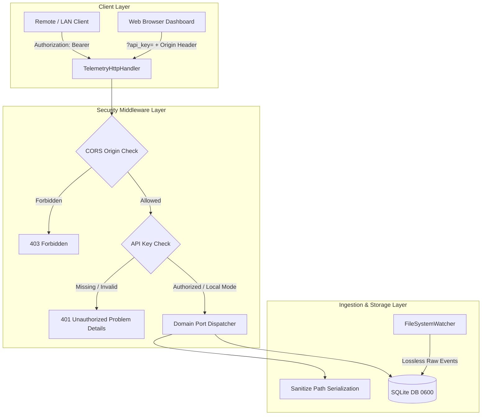

# SDD-027: Perimeter Network Guarding, Storage Hardening, and Sensitive Telemetry Controls

## 1. Executive Summary

This Software Design Document specifies the technical implementation for hardening `ed-telemetry` against external and multi-user attack vectors as defined in [ADR 0029](file:///home/michael/src/github.com/mnaatjes/ed-telemetry/architecture/adr/0029_perimeter_network_guarding_and_storage_hardening.md):
1. **Local Storage Hardening:** POSIX permission masking (`0700` dir / `0600` files) in `SqlitePersistenceManager` and logging setup.
2. **Perimeter Authentication:** Pre-shared API Key verification in `HttpApiAdapter` and `TelemetryHttpHandler`.
3. **CORS Governance:** Configurable origin matching replacing hardcoded `*` in HTTP response headers.
4. **Host Path Masking:** Sanitization of operating system paths in API responses.
5. **CLI Credential Management:** Implementation of `auth` subcommands (`keygen`, `show`, `revoke`) and resolution hierarchy.

---

## 2. Architecture & Data Flow



---

## 3. Detailed Component Design

### 3.1 Local Storage Hardening (`sqlite_adapter.py` & `paths.py`)

In `src/ed_telemetry/adapters/driven/persistence/sqlite_adapter.py`:
```python
def _enforce_posix_permissions(path: Path, is_dir: bool = False) -> None:
    if os.name == "posix":
        target_mode = 0o700 if is_dir else 0o600
        try:
            os.chmod(path, target_mode)
        except OSError:
            pass
```
* On `SqlitePersistenceManager.__init__()`:
  - Invoke `_enforce_posix_permissions(self.db_path.parent, is_dir=True)`.
  - Create database file with restricted mode and enforce on `telemetry.db`, `telemetry.db-wal`, and `telemetry.db-shm`.

### 3.2 Perimeter Authentication Middleware (`server.py`)

In `src/ed_telemetry/adapters/driving/api/server.py`:
1. Injected configuration parameters in `HttpApiAdapter`:
   - `api_key: str | None = None`
   - `allowed_origins: tuple[str, ...] = ("http://localhost", "http://127.0.0.1", "http://[::1]")`
2. Authentication check inside `TelemetryHttpHandler`:
   ```python
   def _authenticate_request(self) -> bool:
       if not self.server_api_key:
           return True

       # 1. Check Bearer token
       auth_hdr = self.headers.get("Authorization", "")
       if auth_hdr.startswith("Bearer "):
           token = auth_hdr[7:].strip()
           if hmac.compare_digest(token, self.server_api_key):
               return True

       # 2. Check X-API-Key header
       api_key_hdr = self.headers.get("X-API-Key", "")
       if api_key_hdr and hmac.compare_digest(api_key_hdr, self.server_api_key):
           return True

       # 3. Check query param for SSE EventSource
       parsed_query = parse_qs(urlparse(self.path).query)
       if "api_key" in parsed_query:
           query_token = parsed_query["api_key"][0]
           if hmac.compare_digest(query_token, self.server_api_key):
               return True

       self._send_problem(status_code=401, title="Unauthorized", detail="Invalid or missing API key.", instance=self.path)
       return False
   ```

### 3.3 CORS Origin Policy (`server.py`)
1. Implement `do_OPTIONS()` in `TelemetryHttpHandler` to handle preflight requests.
2. In `_send_json`, `_send_problem`, and `_stream_sse`:
   - Inspect incoming `Origin` request header.
   - If origin starts with any entry in `allowed_origins` or matches loopback regex:
     - Set `Access-Control-Allow-Origin: <origin>`
     - Set `Access-Control-Allow-Methods: GET, OPTIONS`
     - Set `Access-Control-Allow-Headers: Authorization, X-API-Key, Content-Type`
   - Otherwise, omit `Access-Control-Allow-Origin`.

### 3.4 Host Path Sanitization (`main.py` & serializers)
* Utility function in `ed_telemetry.adapters.paths`:
  ```python
  def sanitize_host_path(path: str | Path | None) -> str | None:
      if not path:
          return None
      p_str = str(path)
      user_home = str(Path.home())
      if p_str.startswith(user_home):
          return p_str.replace(user_home, "~", 1)
      return p_str
  ```
* Apply `sanitize_host_path()` in `_handle_status` and `TelemetryHttpHandler.do_GET` for `/status` and `/status/game`.

### 3.5 CLI Credential Resolution & Utility (`main.py`)
1. Add `auth` subparser with commands:
   - `keygen [--force]`: Generate and write credentials to `~/.config/ed-telemetry/credentials.json` with `0600` permissions.
   - `show`: Output active key location and status.
   - `revoke`: Delete credentials file.
2. Update `_handle_serve` to resolve key in deterministic order:
   - `args.api_key` $\rightarrow$ `$ED_API_KEY` $\rightarrow$ `credentials.json` $\rightarrow$ `None`.

---

## 4. Verification & Testing Strategy

1. **Unit Tests (`tests/unit/adapters/test_security_controls.py`):**
   - Verify `0700` and `0600` permissions set on POSIX filesystem.
   - Test `_authenticate_request` against valid/invalid Bearer tokens, `X-API-Key`, and query parameters.
   - Verify constant-time comparison via `hmac.compare_digest`.
   - Test CORS matching against `localhost`, allowed remote origins, and disallowed origins.
   - Verify path sanitization masks `/home/<user>`.
2. **End-to-End CLI Verification:**
   - Verify `ed-telemetry auth keygen` creates valid credentials file.
   - Verify `ed-telemetry serve --api-key <key>` rejects unauthenticated curl requests with 401.
   - Verify authenticated requests succeed.
