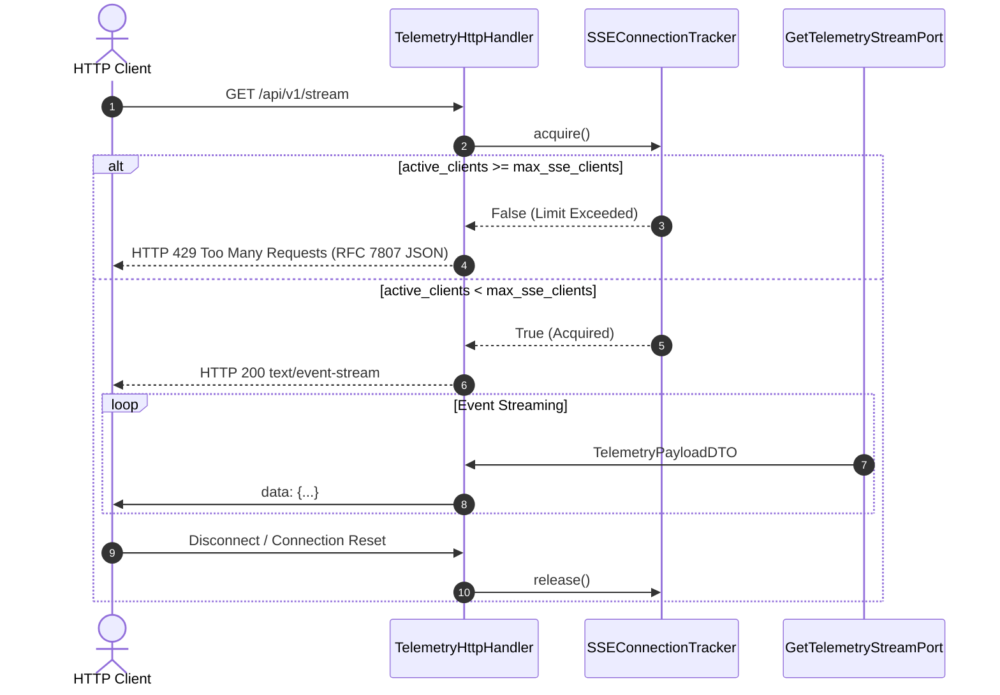

# SDD-028: API Resource Starvation Guardrails and Concurrency Throttling

## 1. Executive Summary

This Software Design Document specifies the technical design for mitigating resource exhaustion vectors in `ed-telemetry` as mandated by [ADR 0030](file:///home/michael/src/github.com/mnaatjes/ed-telemetry/architecture/adr/0030_api_resource_starvation_guardrails.md) and [Issue #78](https://github.com/mnaatjes/ed-telemetry/issues/78):
1. **Query Ceiling Guardrails:** Clamping `?limit=` parameters on `/api/v1/events` and `/api/v1/diagnostics/logs` between 1 and 500.
2. **SSE Concurrency Limiter:** Managing active SSE client connections via a thread-safe atomic counter with a configurable threshold (`max_sse_clients = 16`).

---

## 2. Architecture & Control Flow



---

## 3. Detailed Component Design

### 3.1 Query Parameter Clamping Helper (`server.py`)

A helper function safely parses and clamps limit parameters:

```python
def _parse_clamped_limit(query: dict[str, list[str]], default: int = 100, min_val: int = 1, max_val: int = 500) -> int:
    """Parse and clamp integer limit query parameter within safe bounds."""
    if "limit" not in query:
        return default
    try:
        val = int(query["limit"][0])
        return max(min_val, min(val, max_val))
    except (ValueError, IndexError):
        return default
```

Applied to:
- `/api/v1/events`: Default 100, clamped to `[1, 500]`.
- `/api/v1/diagnostics/logs`: Default 100, clamped to `[1, 500]`.

### 3.2 Thread-Safe SSE Connection Tracker (`server.py`)

A synchronization manager controls concurrent active stream counts:

```python
class SSEConnectionTracker:
    """Thread-safe active SSE client tracker with concurrency cap."""

    def __init__(self, max_clients: int = 16) -> None:
        self.max_clients = max_clients
        self._lock = threading.Lock()
        self._active_clients = 0

    def acquire(self) -> bool:
        """Attempt to acquire a stream slot. Returns True if granted."""
        with self._lock:
            if self._active_clients >= self.max_clients:
                return False
            self._active_clients += 1
            return True

    def release(self) -> None:
        """Release a stream slot upon client disconnect."""
        with self._lock:
            if self._active_clients > 0:
                self._active_clients -= 1

    @property
    def active_count(self) -> int:
        """Current number of connected streaming clients."""
        with self._lock:
            return self._active_clients
```

### 3.3 Handler Integration

Inside `TelemetryHttpHandler._handle_sse_stream()`:
1. Verify slot via `self.sse_tracker.acquire()`.
2. If `False`, emit `_send_problem(429, "Too Many Requests", f"Maximum concurrent SSE stream limit reached ({self.sse_tracker.max_clients} clients).", self.path)`.
3. If `True`, proceed to stream; upon stream exit or broken pipe, ensure `self.sse_tracker.release()` in a `finally` block.

---

## 4. Verification & Testing Strategy

1. **Query Bounds Unit Tests:**
   - Request `?limit=-10` $\rightarrow$ results clamped to 1.
   - Request `?limit=10000` $\rightarrow$ results clamped to 500.
2. **SSE Concurrency Unit Tests:**
   - Configure `max_sse_clients = 2`.
   - Open 2 active persistent stream connections.
   - Assert 3rd connection is immediately rejected with `HTTP 429` and RFC 7807 JSON.
   - Disconnect 1 client $\rightarrow$ next connection succeeds.
