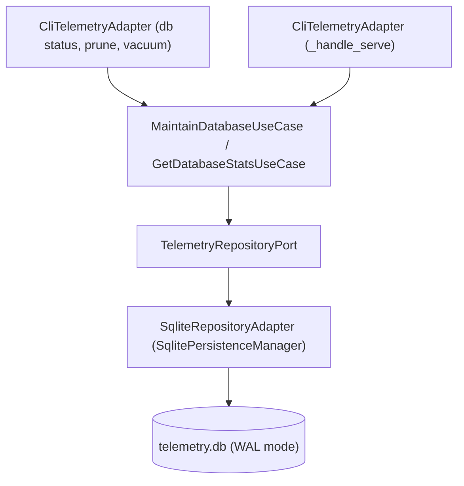

# SDD-031: Configurable Database Retention and Maintenance

## 1. System Overview

This Software Design Document specifies the architecture, boundary contracts, and implementation details for configurable telemetry database retention and maintenance in `ed-telemetry`, realizing [ADR 0034](file:///home/michael/src/github.com/mnaatjes/ed-telemetry/architecture/adr/0034_configurable_database_retention_and_maintenance.md).



---

## 2. Boundary Contracts & Data Transfer Objects

### 2.1 Domain DTOs (`core/ports/dto/telemetry_dto.py`)

```python
@dataclass(frozen=True, slots=True)
class DatabaseStatsDTO(DataTransferObject):
    """Metrics and operational state of the telemetry persistence store."""

    db_path: str
    file_size_bytes: int
    total_events: int
    oldest_event_timestamp: datetime | None
    newest_event_timestamp: datetime | None


@dataclass(frozen=True, slots=True)
class DatabaseMaintenanceResultDTO(DataTransferObject):
    """Summary of database maintenance operations."""

    pruned_count: int
    vacuumed: bool
    initial_size_bytes: int
    final_size_bytes: int
```

### 2.2 Driven Port Extensions (`core/ports/driven/telemetry_driven_port.py`)

```python
@runtime_checkable
class TelemetryRepositoryPort(DrivenPort, Protocol):
    ...

    def get_database_stats(self) -> DatabaseStatsDTO: ...
    def prune_events(self, older_than: datetime | None = None, max_records: int | None = None) -> int: ...
    def vacuum(self) -> None: ...
```

### 2.3 Driving Port Contracts (`core/ports/driving/telemetry_port.py`)

```python
@runtime_checkable
class GetDatabaseStatsPort(DrivingPort, Protocol):
    def get_stats(self) -> DatabaseStatsDTO: ...


@runtime_checkable
class MaintainDatabasePort(DrivingPort, Protocol):
    def maintain(
        self,
        retention_days: int | None = None,
        max_records: int | None = None,
        run_vacuum: bool = False,
    ) -> DatabaseMaintenanceResultDTO: ...
```

---

## 3. Implementation Specifications

### 3.1 Pruning Query Execution (`SqliteRepositoryAdapter`)

1. **Age-Based Pruning:**
   ```sql
   DELETE FROM telemetry_events WHERE timestamp < ?
   ```
2. **Record-Count Pruning (FIFO):**
   ```sql
   DELETE FROM telemetry_events WHERE id IN (
       SELECT id FROM telemetry_events ORDER BY id DESC LIMIT -1 OFFSET ?
   )
   ```
3. **Vacuum:**
   ```sql
   VACUUM
   ```

### 3.2 CLI Subcommand Specifications (`db`)

1. `ed-telemetry db status [--json]`
2. `ed-telemetry db prune [--days N] [--max-records N] [--vacuum] [--force] [--json]`
3. `ed-telemetry db vacuum [--json]`

### 3.3 Serve Integration Flags (`serve`)

- `--retention-days`: Integer days to retain (fallback: `$ED_DB_RETENTION_DAYS`).
- `--retention-max-records`: Maximum record ceiling (fallback: `$ED_DB_MAX_RECORDS`).
