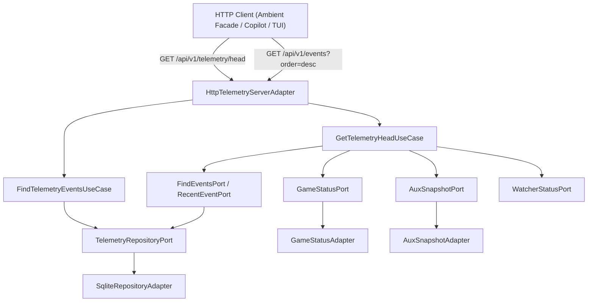

# SDD-032: Non-Destructive Telemetry Head State Endpoint and Reverse Index Queries

## 1. System Overview

This Software Design Document specifies the architecture, boundary contracts, and implementation specifications for the non-destructive telemetry head state endpoint and bidirectional query support in `ed-telemetry`, realizing [ADR 0036](file:///home/michael/src/github.com/mnaatjes/ed-telemetry/architecture/adr/0036_non_destructive_telemetry_head_state_endpoint.md).



---

## 2. Boundary Contracts & Data Transfer Objects

### 2.1 Domain DTOs (`core/models/dto.py`)

```python
from dataclasses import dataclass
from datetime import datetime
from typing import Any, Literal
from ed_telemetry.core.models.dto import DataTransferObject, TelemetryRecordDTO, GameStatusDTO, AuxiliarySnapshotDTO


@dataclass(frozen=True, slots=True)
class TelemetryQueryDTO(DataTransferObject):
    """Query criteria for retrieving persisted telemetry events."""

    since_id: int | None = None
    topic: str | None = None
    limit: int = 100
    order: Literal["asc", "desc"] = "asc"


@dataclass(frozen=True, slots=True)
class TelemetryHeadDTO(DataTransferObject):
    """Consolidated instantaneous head state snapshot."""

    timestamp: datetime
    active_journal: str | None
    latest_journal_event: TelemetryRecordDTO | None
    game_status: GameStatusDTO | None
    snapshots: dict[str, AuxiliarySnapshotDTO]
```

---

## 3. Core Domain Use Cases

### 3.1 `GetTelemetryHeadUseCase` (`core/use_cases/get_telemetry_head.py`)

Orchestrates retrieval of head state across driving ports:

```python
class GetTelemetryHeadUseCase:
    """Retrieves consolidated point-in-time head state without dequeuing items."""

    def __init__(
        self,
        repository: TelemetryRepositoryPort,
        game_status_port: GameStatusPort,
        aux_snapshot_port: AuxSnapshotPort,
        watcher_status_port: WatcherStatusPort,
    ) -> None:
        self._repository = repository
        self._game_status_port = game_status_port
        self._aux_snapshot_port = aux_snapshot_port
        self._watcher_status_port = watcher_status_port

    def get_head(self) -> TelemetryHeadDTO:
        # 1. Fetch latest journal event via DESC query
        latest_records = self._repository.find_events(
            TelemetryQueryDTO(topic="telemetry.journal", limit=1, order="desc")
        )
        latest_event = latest_records[0] if latest_records else None

        # 2. Fetch active status and snapshots
        watcher_status = self._watcher_status_port.get_status()
        status_dto = self._game_status_port.get_game_status()

        snapshots: dict[str, AuxiliarySnapshotDTO] = {}
        for snap_name in ("NavRoute.json", "Market.json", "Cargo.json", "Shipyard.json", "Outfitting.json"):
            try:
                snap = self._aux_snapshot_port.get_snapshot(snap_name)
                if snap.exists:
                    snapshots[snap_name.replace(".json", "")] = snap
            except Exception:
                continue

        return TelemetryHeadDTO(
            timestamp=datetime.now(timezone.utc),
            active_journal=watcher_status.active_journal,
            latest_journal_event=latest_event,
            game_status=status_dto,
            snapshots=snapshots,
        )
```

---

## 4. HTTP Adapter Routing Specifications

### 4.1 Route Specification: `GET /api/v1/telemetry/head`
* **Authentication:** Subject to standard perimeter rules (loopback or pre-shared bearer token).
* **Idempotency:** Pure read; non-destructive; does not mutate buffer queues.
* **Response Status:** `200 OK`
* **Content-Type:** `application/json`

### 4.2 Route Specification: `GET /api/v1/events`
* **Query Parameters:**
  * `since_id`: Integer minimum ID boundary.
  * `topic`: Topic filter string.
  * `limit`: Clamped between 1 and 500 (default: 100).
  * `order`: Case-insensitive string `asc` or `desc` (default: `asc`).
* **SQL Query Execution in `SqliteRepositoryAdapter`:**
  ```python
  sort_order = "DESC" if query.order.lower() == "desc" else "ASC"
  sql = (
      "SELECT id, event_id, topic, timestamp, raw_hash, payload_json, created_at "
      f"FROM telemetry_events {where_sql} ORDER BY id {sort_order} LIMIT ?"
  )
  ```
