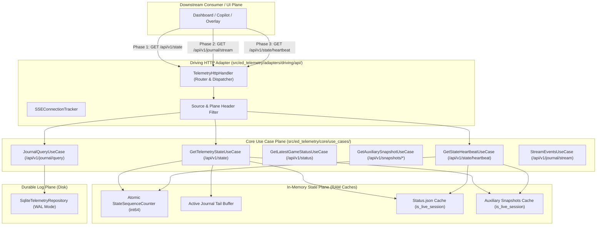

# SDD-033: Resource-First API Taxonomy, Zero-DB Head Hydration, and Storage Source Transparency Implementation Guide

## 1. System Overview & Architectural Topology

This Software Design Document formalizes the implementation specifications, boundary contracts, and verification plans for [ADR 0038](file:///home/michael/src/github.com/mnaatjes/ed-telemetry/architecture/adr/0038_api_endpoint_taxonomy_dual_plane_model_and_state_heartbeat.md).



---

## 2. Boundary Contracts & Data Transfer Objects

### 2.1 Domain DTO Enhancements (`src/ed_telemetry/core/ports/dto/telemetry_dto.py`)

```python
from dataclasses import dataclass
from datetime import datetime
from uuid import UUID

from ..base import DataTransferObject


@dataclass(frozen=True, slots=True)
class TelemetryHeadDTO(DataTransferObject):
    """Consolidated instantaneous head state snapshot (100% In-Memory)."""

    state_sequence: int
    timestamp: datetime
    active_journal: str | None
    latest_journal_event: TelemetryRecordDTO | None
    game_status: GameStatusSnapshotDTO | None
    snapshots: dict[str, AuxiliarySnapshotDTO]


@dataclass(frozen=True, slots=True)
class TelemetryHeartbeatDTO(DataTransferObject):
    """Ultra-lightweight state synchronization heartbeat (< 200 bytes)."""

    state_sequence: int
    timestamp: datetime
    active_journal: str | None
    latest_event_id: str | None
    status_hash: str | None
    snapshot_hashes: dict[str, str]


@dataclass(frozen=True, slots=True)
class GameStatusSnapshotDTO(DataTransferObject):
    """Extracted payload and metadata for Status.json."""

    exists: bool
    is_live_session: bool
    target_path: str | None
    timestamp: datetime | None
    raw_payload: bytes
    raw_hash: str | None


@dataclass(frozen=True, slots=True)
class AuxiliarySnapshotDTO(DataTransferObject):
    """Extracted payload and metadata for an auxiliary snapshot file."""

    target_name: str
    exists: bool
    is_live_session: bool
    target_path: str | None
    timestamp: datetime | None
    raw_payload: bytes
    raw_hash: str | None
```

### 2.2 Inbound Driving Ports (`src/ed_telemetry/core/ports/driving/telemetry_port.py`)

```python
from typing import Protocol, runtime_checkable
from ..base import DrivingPort
from ..dto.telemetry_dto import TelemetryHeadDTO, TelemetryHeartbeatDTO


@runtime_checkable
class GetTelemetryStatePort(DrivingPort, Protocol):
    """Driving port for retrieving instantaneous consolidated state."""

    def get_state(self) -> TelemetryHeadDTO: ...


@runtime_checkable
class GetStateHeartbeatPort(DrivingPort, Protocol):
    """Driving port for retrieving state delta heartbeat."""

    def get_heartbeat(self) -> TelemetryHeartbeatDTO: ...
```

---

## 3. Concrete Implementation Specifications

### 3.1 Monotonic Sequence Counter (`src/ed_telemetry/core/state/sequence.py`)
* Thread-safe atomic monotonic counter (`StateSequenceTracker`).
* Increments on:
  1. Journal line appended.
  2. `Status.json` modified.
  3. Any registered auxiliary snapshot file modified.
* Provides single atomic read for `/api/v1/state` and `/api/v1/state/heartbeat`.

### 3.2 Preloading Invariant (`Invariant 4`) in Ingestion Reactor
* In `FileIngestionCoordinator` / `SnapshotReader`:
  * During startup, scan the journal directory for registered snapshot files (`Cargo.json`, `Market.json`, etc.).
  * Read existing disk contents into memory with `is_live_session = False`.
  * When inotify/polling detects a runtime modification during active gameplay, update memory cache and set `is_live_session = True`.

### 3.3 Zero-DB Hydration Invariant (`Invariant 1`) in `GetTelemetryStateUseCase`
* Completely eliminate `self._repository.find_events(...)` fallback.
* Read `latest_journal_event` exclusively from `self._watcher_port.read_active_journal_tail()`. If `None`, set `latest_journal_event = None`.

### 3.4 Routing & Header Injection in `TelemetryHttpHandler`
* Add canonical dispatch table:
  * `/api/v1/state` $\rightarrow$ `_handle_state`
  * `/api/v1/state/heartbeat` $\rightarrow$ `_handle_heartbeat`
  * `/api/v1/status` $\rightarrow$ `_handle_status`
  * `/api/v1/snapshots` and `/api/v1/snapshots/{name}` $\rightarrow$ `_handle_snapshots`
  * `/api/v1/journal/latest` $\rightarrow$ `_handle_journal_latest`
  * `/api/v1/journal/query` $\rightarrow$ `_handle_journal_query`
  * `/api/v1/journal/stream` $\rightarrow$ `_handle_sse_stream`
  * `/api/v1/journal/queue` $\rightarrow$ `_handle_events_buffer`
  * `/api/v1/system/health`, `watcher`, `logs`, `control`
* Map legacy routes (`/api/v1/telemetry/head`, `/api/v1/status/game`, `/api/v1/events`, etc.) to their canonical handlers.
* Wrap all response writers to inject:
  * `X-Telemetry-Source: memory-buffer | sqlite-wal`
  * `X-Telemetry-Plane: state | status | snapshots | journal | system`
  * `ETag: W/"<seq>-<hash>"` on state responses.
  * Respond with `304 Not Modified` if request contains matching `If-None-Match`.

---

## 4. Verification & Testing Strategy

### 4.1 Unit Tests (`tests/unit/adapters/test_http_api.py`)
1. **Canonical Route Coverage:** Test every new endpoint (`/state`, `/status`, `/snapshots`, `/journal/*`, `/system/*`).
2. **Legacy Route Alias Verification:** Test all deprecated endpoints (`/telemetry/head`, `/status/game`, `/events`, etc.) and verify identical payload parity.
3. **Header Assertion Test:** Assert `X-Telemetry-Source` and `X-Telemetry-Plane` headers exist and match expected values on every response.
4. **ETag & 304 Test:** Send `If-None-Match: <etag>` and assert `304 Not Modified` with zero body bytes.
5. **Zero-DB State Test:** Verify `/api/v1/state` executes zero SQL queries (mock repository to confirm 0 calls).
6. **Preloading & Freshness Flag Test:** Assert `is_live_session == False` on initial startup and transitions to `True` on file write.

### 4.2 Architectural Compliance Test (`tests/architecture/test_api_standards.py`)
1. **Regex Path Conformance:** Assert that every route in `server.py` matches the approved canonical pattern or the deprecated alias list.
2. **OpenAPI Parity:** Load `architecture/api/openapi.yaml` and assert 1:1 bi-directional parity with router paths.
3. **Execution in Verification Suite:** Codified directly into `.venv/bin/python scripts/verify.py`.

---

## 5. Implementation Step Checklist

1. [ ] **Domain & DTO Layer:** Update `telemetry_dto.py` with `state_sequence`, `is_live_session`, and `TelemetryHeartbeatDTO`.
2. [ ] **Ports Layer:** Add `GetTelemetryStatePort` and `GetStateHeartbeatPort` to `telemetry_port.py`.
3. [ ] **Core Use Cases:**
   * Update `GetTelemetryHeadUseCase` (rename/alias to `GetTelemetryStateUseCase`), removing all SQL fallback queries.
   * Create `GetStateHeartbeatUseCase`.
4. [ ] **Watcher / Ingestion Reactor:** Implement startup snapshot preloading with `is_live_session=False`.
5. [ ] **Driving HTTP Adapter:**
   * Add canonical routes and wire legacy aliases.
   * Implement `X-Telemetry-Source`, `X-Telemetry-Plane`, and `ETag` header injection.
   * Add `304 Not Modified` evaluation on `/state` and `/state/heartbeat`.
6. [ ] **OpenAPI & Reference Docs:** Update `architecture/api/openapi.yaml` and `docs/reference/http_api_endpoints.md`.
7. [ ] **Quality Gates:** Add `tests/architecture/test_api_standards.py` and run `.venv/bin/python scripts/verify.py`.
