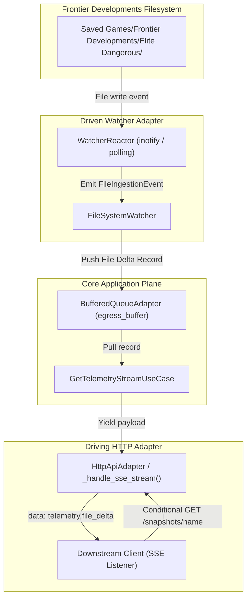

# SDD-034: SSE File Delta Push Notifications Implementation Guide

## 1. System Overview & Architecture

This document formalizes the software design for [ADR 0039](file:///home/michael/src/github.com/mnaatjes/ed-telemetry/architecture/adr/0039_sse_file_delta_push_notifications.md).



## 2. Component Modifications

### 2.1 File Delta Telemetry Record Generation
In `ed_telemetry.adapters.driven.watcher.watcher.FileSystemWatcher`, whenever an auxiliary snapshot or status file write is detected:
1. Construct a lightweight `TelemetryRecordDTO`:
   * `topic`: `"telemetry.file_delta"`
   * `timestamp`: Detection timestamp (UTC)
   * `payload_bytes`: JSON-encoded payload:
     ```json
     {
       "topic": "telemetry.file_delta",
       "target": "<filename>",
       "action": "modified",
       "raw_hash": "<hash>",
       "timestamp": "<iso-timestamp>"
     }
     ```
2. Forward the record to the registered event handlers / egress buffer.

### 2.2 Streaming HTTP Handler (`_handle_sse_stream`)
In `ed_telemetry.adapters.driving.api.server.TelemetryHttpHandler._handle_sse_stream`:
* When `payload.topic == "telemetry.file_delta"`, serialize directly into the SSE stream without altering existing `telemetry.journal` handling.
