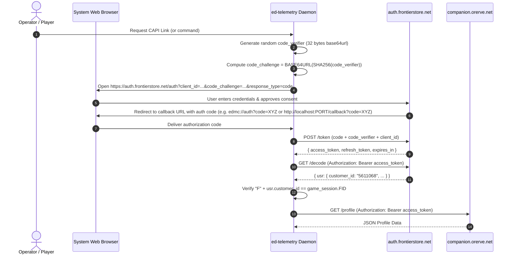

# Frontier Companion API (CAPI) Architecture, Schemas, and Registration Specification

## 1. Executive Summary

This research specification establishes the authoritative integration blueprint for the **Frontier Companion API (CAPI)**. Originally developed by Frontier Developments to power the official iOS companion application, CAPI provides deep server-side access to a Commander's profile, full remote shipyard inventories, active station market prices, stored fleet carrier states, and raw outfitting modules.

This document details:
1. Target servers and API endpoints.
2. The OAuth 2.0 PKCE authentication handshake and local callback mechanisms.
3. Response schemas and JSON structures for all endpoints.
4. The registration process via Frontier's developer portal (`auth.frontierstore.net`).
5. Architectural rules, rate limits, and caching requirements for `ed-telemetry`.

---

## 2. Infrastructure & Target Endpoints

Frontier hosts separate CAPI clusters corresponding to game environment branches:

| Environment | Base URL | Usage |
| :--- | :--- | :--- |
| **Live (Odyssey / 4.0)** | `https://companion.orerve.net` | Production Live 4.0 Galaxy |
| **Legacy (Horizons 3.8)** | `https://legacy-companion.orerve.net` | Legacy 3.8 galaxy branch |
| **Public Test / Beta (PTS)**| `https://pts-companion.orerve.net` | Frontier experimental beta tests |
| **Auth & Identity Server** | `https://auth.frontierstore.net` | OAuth 2.0 token issuer and decode service |

### Known CAPI Endpoints

```
GET /profile
GET /market
GET /shipyard
GET /fleetcarrier
```

---

## 3. Communication & Authentication Workflow (OAuth 2.0 PKCE)

Because desktop clients cannot keep a client secret confidential, Frontier mandates **OAuth 2.0 with PKCE (Proof Key for Code Exchange, RFC 7636)** using the `S256` code challenge method.



### Callback Handling Strategies
Community tools implement one of two redirect mechanisms:
1. **Custom Protocol URI (`edmc://auth` or `edtelemetry://auth`):**
   Requires registering a custom URI scheme in the Windows Registry (`HKEY_CURRENT_USER\Software\Classes\edmc`) or Linux desktop mime database (`xdg-mime`). The OS automatically routes the redirect URL to the application binary.
2. **Ephemeral Loopback Webserver (`http://localhost:PORT/callback`):**
   Spins up a temporary local HTTP server on a loopback port to intercept the browser redirect. This avoids OS-level protocol handler registration and works seamlessly in headless environments.

---

## 4. Endpoint Response Schemas & JSON Data Structures

### 4.1 `GET /profile`
Returns the complete state of the commander, active ship, loadout, balance, and stored components.

```json
{
  "commander": {
    "id": 5611068,
    "name": "adulantis",
    "credits": 5235083083,
    "debt": 0,
    "currentShipId": 12,
    "alive": true,
    "docked": true,
    "rank": {
      "combat": 4,
      "trade": 8,
      "explore": 6,
      "cqc": 0,
      "soldier": 3,
      "exobiologist": 2
    }
  },
  "ship": {
    "id": 12,
    "name": "Cobra Mk V",
    "shipName": "WANDERER",
    "shipID": "WN-01",
    "value": {
      "hull": 14634527,
      "modules": 48291040,
      "cargo": 0,
      "total": 62925567,
      "unloaned": 62925567
    },
    "free": false,
    "health": {
      "hull": 1000000,
      "shield": 1000000,
      "shieldUp": true,
      "integrity": 1000000
    },
    "cockpitBreached": false,
    "oxygenRemaining": 1500,
    "modules": {
      "PowerPlant": {
        "module": {
          "id": 128049182,
          "name": "int_powerplant_size4_class5",
          "value": 1520000,
          "health": 1000000,
          "on": true,
          "priority": 0
        }
      }
    }
  },
  "lastSystem": {
    "name": "Wregoe YP-G d10-27",
    "id": 849204910293
  },
  "lastStarport": {
    "name": "V4X-N6J",
    "id": 3715110400,
    "services": {
      "dock": true,
      "autodock": true,
      "commodities": true,
      "contacts": true,
      "exploration": true,
      "rearm": true,
      "refuel": true,
      "repair": true,
      "shipyard": true,
      "outfitting": false
    }
  }
}
```

### 4.2 `GET /market`
Emits full commodity pricing, supply, demand, and producer/consumer status for the currently docked station (mirrors `Market.json`).

### 4.3 `GET /shipyard`
Emits all shipyard inventory ships available for sale and remote ship storage tracking (mirrors `Shipyard.json`).

### 4.4 `GET /fleetcarrier`
Provides full management telemetries for the Commander's owned Fleet Carrier:
- Current jump destination and lock timer.
- Fuel capacity (Tritium reserve and depot fuel).
- Carrier bank balances, maintenance debt, and shipyard/outfitting tariff percentages.
- Pack allocations and remote crew employment status.

---

## 5. Registration & Access Process: How to Register

### 5.1 Is Manual Outreach to Frontier Required?
**No.** Frontier Developments does not require bilateral enterprise contracts, legal outreach, or manual developer approval for read-only CAPI integration.

### 5.2 Self-Service Developer Portal (`auth.frontierstore.net`)
Access is provisioned via self-service signup:

1. **Log in to Developer Portal:**
   Navigate to [https://auth.frontierstore.net/client/signup](https://auth.frontierstore.net/client/signup) using your personal Frontier account.
2. **Register Application Metadata:**
   - **Application Name:** `ed-telemetry`
   - **Application Description:** Hexagonal telemetry daemon, SQLite store, and multi-adapter interface for Elite Dangerous.
   - **Allowed Redirect URIs:**
     - For loopback server: `http://localhost:8088/callback` and `http://127.0.0.1:8088/callback`
     - For custom protocol: `edtelemetry://auth`
3. **Receive Application Identifiers:**
   The portal provisions an immutable **`client_id`** (UUID v4 format, e.g. `fb88d428-9110-475f-a3d2-dc151c2b9c7a`).
   *Note:* Because CAPI uses PKCE for public clients, no `client_secret` is required or issued.

---

## 6. Operational Guardrails, Rate Limits, and Cooldowns

Frontier enforces aggressive anti-hammering filters on CAPI. Client implementations must strictly observe these timing invariants:

| Constraint | Minimum Delay | Enforcement Rule in Code |
| :--- | :--- | :--- |
| **Station / Profile Queries** | **60 seconds** | Cooldown timer between subsequent `/profile`, `/market`, `/shipyard` batches. |
| **Fleet Carrier Query** | **15 minutes (900s)** | Minimum cooldown between calls to `/fleetcarrier`. |
| **HTTP Request Timeout** | **10–60 seconds** | Standard requests timeout at 10s; `/fleetcarrier` queries can take up to 60s. |
| **HTTP Status 429 & 5xx** | Exponential backoff | Must backoff (`0.5s`, `1s`, `2s`) on `429 Too Many Requests` or `500`/`502`/`503`. |

---

## 7. Architectural Recommendations for `ed-telemetry`

When authoring a CAPI driving or driven adapter in `ed-telemetry`:
1. **Ports & Adapters Boundary:** Place CAPI logic in `src/ed_telemetry/adapters/driven/capi/`. The core domain must not know about Frontier OAuth tokens or CAPI endpoints.
2. **Hybrid Ingestion Driver:** When local journal files lack complete shipyard module details or carrier bank stats, CAPI should act as an auxiliary ingestion feeder into `SyncJournalSnapshotUseCase`.
3. **Identity Equivalence Gate:** Always verify that `usr.customer_id` from `/decode` matches `session.FID` before saving state or broadcasting events.
4. **Zero-Dependency Ephemeral Server:** For headless/CLI use, spin up an ephemeral standard library `http.server` on `127.0.0.1:8088` to catch the browser OAuth redirect cleanly without external GUI frameworks.
