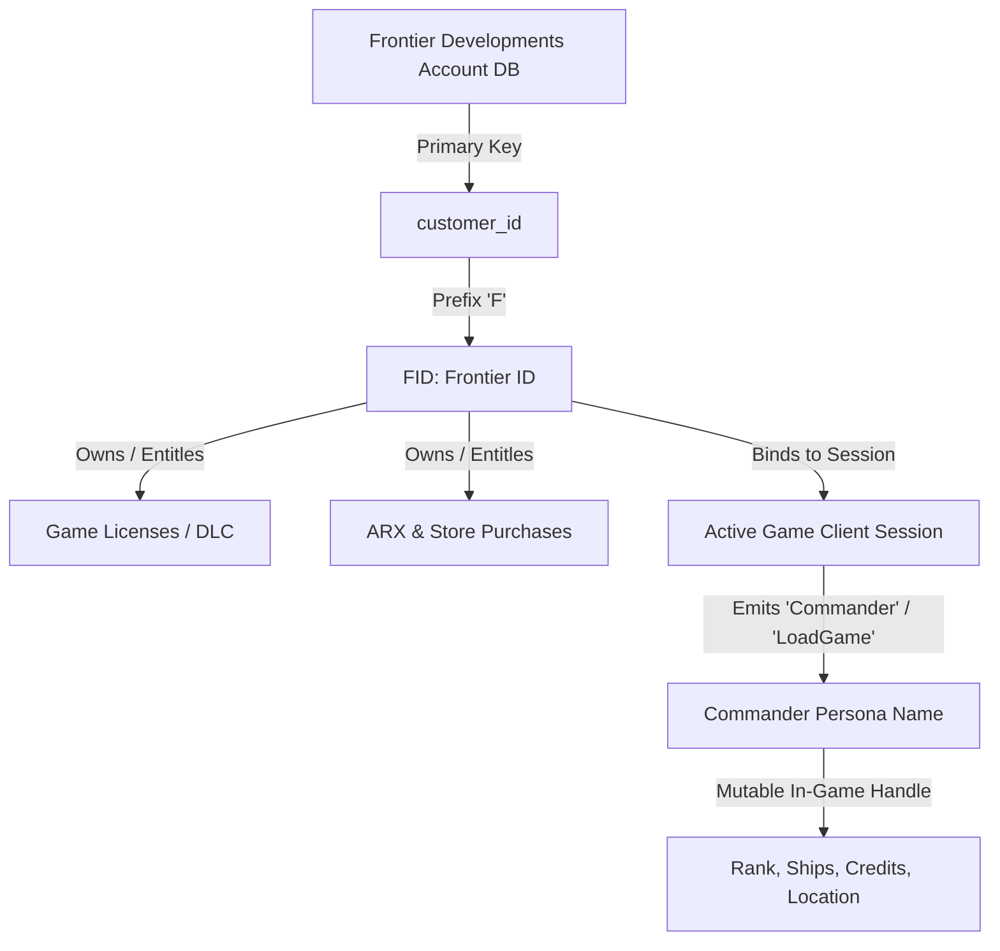
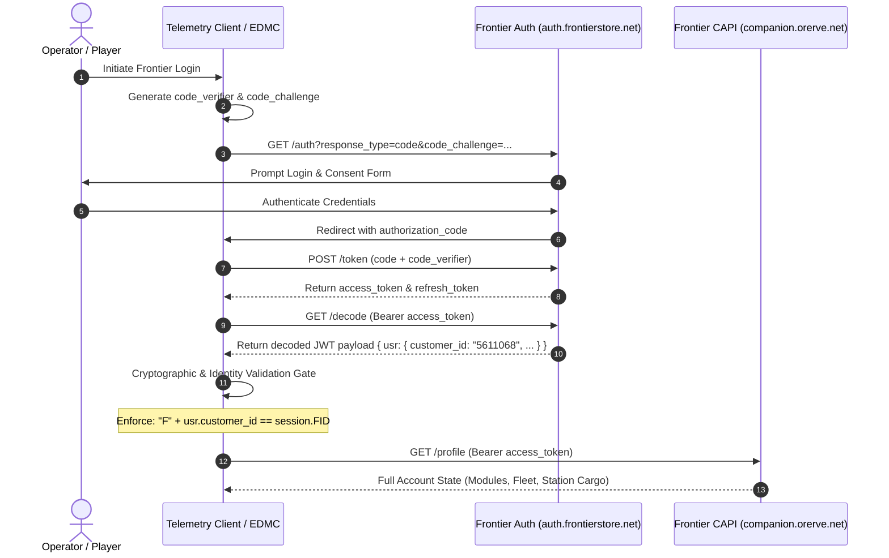
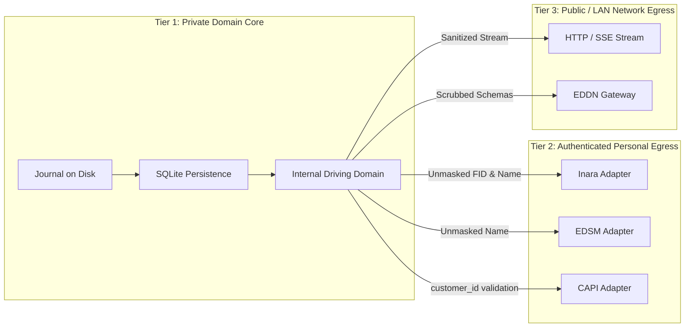

# Frontier Identity Architecture and Third-Party Egress Specification

## 1. Executive Summary

This research specification establishes the authoritative data contract governing player identity attributes—specifically the **Frontier Customer Identifier (`FID`)** and **Commander Name (`cmdr`)**—produced by *Elite Dangerous* telemetry. It documents the relationship between journal identity properties and Frontier Developments' (FDev) backend billing systems, details the Frontier Companion API (CAPI) OAuth 2.0 PKCE authentication handshake, catalogs third-party egress integration contracts (Inara, EDSM, EDDN), and formalizes the redaction boundaries required for `ed-telemetry` egress adapters.

---

## 2. Frontier Identity Architecture

Frontier telemetry establishes a strict separation between persistent customer accounts and mutable in-game personas.



### 2.1 The Frontier Customer Identifier (`FID`)
* **Underlying Structure:** The `FID` is a literal string representation of the root database account identifier within Frontier Developments' master Customer Relationship Management (CRM) and store infrastructure:
  `FID = "F" + customer_id`
* **Immutability:** The `FID` is globally unique, permanent, and tied to the purchasing human entity. It persists across commander renames, save wipes ("Clear Save"), game client reinstallations, and platform linking (Steam/Epic/Standalone).
* **Entitlements Bound to `FID`:**
  - Frontier Store order history and purchase receipts.
  - Microtransactions (ARX balance, paint jobs, ship kits, voice packs).
  - Software entitlements (Odyssey expansion licenses, Horizons access).
* **Journal Injection Points:**
  - `Commander` event: `{"timestamp":"...", "event":"Commander", "FID":"F5611068", "Name":"adulantis"}`
  - `LoadGame` event: `{"timestamp":"...", "event":"LoadGame", "FID":"F5611068", "Commander":"adulantis", ...}`

### 2.2 The Commander Persona Name
* **Underlying Structure:** A user-selected UTF-8 alphanumeric string.
* **Mutability:** Mutable. Players can rename commanders via Frontier Customer Support or generate new names following a game save wipe.
* **Scope:** Represents the in-game public actor in Open Play, private groups, and fleet logs.

---

## 3. Frontier Companion API (CAPI) & OAuth 2.0 Workflow

Frontier provides a REST-based Companion API (CAPI) hosted at `https://companion.orerve.net/` backed by their single-sign-on authentication provider at `https://auth.frontierstore.net/`.

### 3.1 OAuth 2.0 PKCE Authentication Sequence

Community tools (such as EDMarketConnector) negotiate CAPI authorization via the Authorization Code Flow with Proof Key for Code Exchange (PKCE, RFC 7636).



### 3.2 The `customer_id` Validation Gate
To prevent session hijacking or storing data against a mismatched account, the client must perform an identity equivalence check before storing refresh tokens or querying CAPI profiles:

```python
# Reference Implementation: EDMarketConnector companion.py
usr = data_decode.get("usr")
if not usr or f"F{usr.get('customer_id')}" != monitor.state.get("FID"):
    raise CredentialsError("Error: customer_id doesn't match active game session!")
```

* **Security Invariant:** If a user logs into Frontier Store with Account A while their game client is executing under Account B, the authorization must fail immediately.

---

## 4. Third-Party Integration Matrix

Different third-party community networks enforce distinct data governance rules regarding `FID` and Commander identity.

| Service | Protocol / Transport | Purpose | Requires `cmdr`? | Requires `FID`? | Schema / Privacy Rules |
| :--- | :--- | :--- | :--- | :--- | :--- |
| **Inara** (`inara.cz`) | HTTP POST JSON batch | Personal flight log, fleet tracking, engineering | **Yes** (`commanderName`) | **Yes** (`commanderFrontierID`) | Stored privately against user's authenticated profile. Header enforces `APIkey`, `commanderName`, `commanderFrontierID`. |
| **EDSM** (`edsm.net`) | HTTP POST Form/JSON | Exploration sync, flight logs, celestial mapping | **Yes** (`commanderName`) | **No** | Requires `commanderName` paired with user's private `apiKey`. `FID` is ignored. |
| **Frontier CAPI** | HTTPS REST (Bearer Token) | Raw station outfitting, fleet storage, journal backfill | **Yes** (session match) | **Yes** (`customer_id`) | Strict validation gate; only permits queries for the exact matching authenticated account. |
| **EDDN** (`edcd.io`) | ZeroMQ / HTTP POST | Public crowd-sourced galaxy data | **Anonymized** (`uploaderID`) | **Strictly Forbidden** | Public broadcast. `FID` is banned by JSON schema. Personal factions, fuel, and location offsets are scrubbed. |

---

## 5. Public Egress Redaction Specifications

When broadcasting events over external network transports (such as `ed-telemetry`'s `/api/v1/stream` or public relays), telemetry data must be sanitized to prevent stream-sniping, PII leakage, and credential harvesting.

### 5.1 Redaction Classification Tiers



### 5.2 Mandatory Public Egress Scrubbing Rules

1. **Social & Human Comms Exclusion:**
   - Drop `ReceiveText` and `SendText` events from default stream relays (prevents accidental leakage of Discord links, passwords, and private coordinate exchanges).
   - Drop `Friends` events (prevents exposing social graph and online presence without consent).
2. **Personal Status Scrubbing (EDDN Compliance):**
   - Strip `ActiveFine`, `Wanted`, `CockpitBreach`, `FuelLevel`, `FuelUsed`, `Latitude`, and `Longitude`.
   - Strip personal faction metrics: `HappiestSystem`, `HomeSystem`, `MyReputation`, `SquadronFaction`.
3. **Identifier Masking (`--redact-pii` Mode):**
   - When configured, replace `FID` with a truncated SHA-256 hash or mask (`F***1068`).
   - Replace filesystem paths (`/home/michael/...`) with virtual prefixes (`~/...`).
